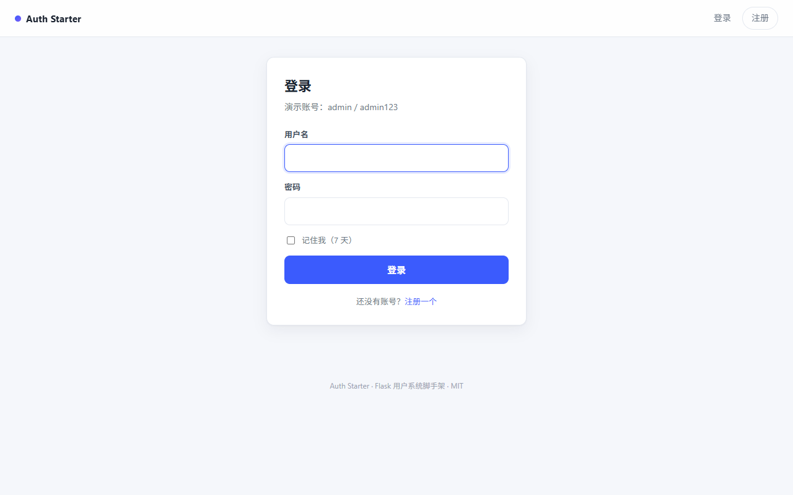
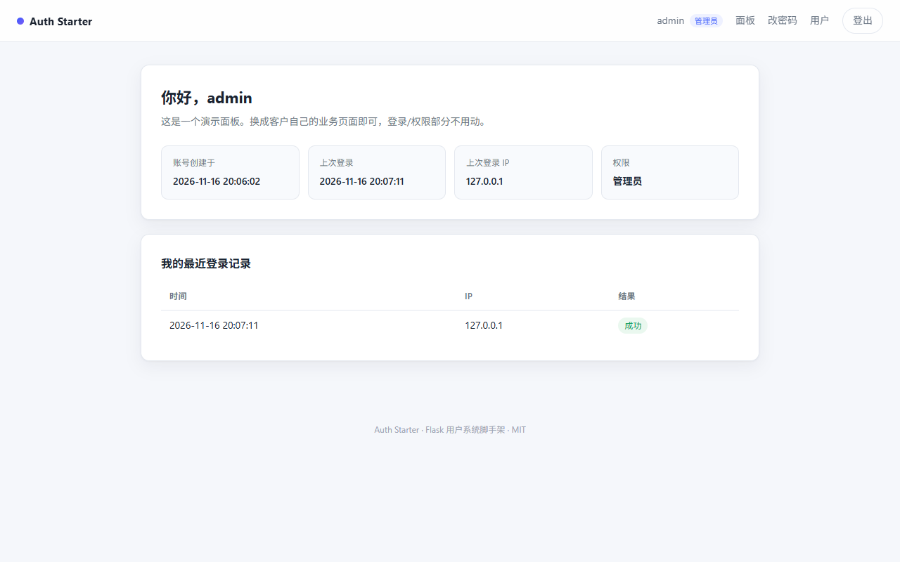
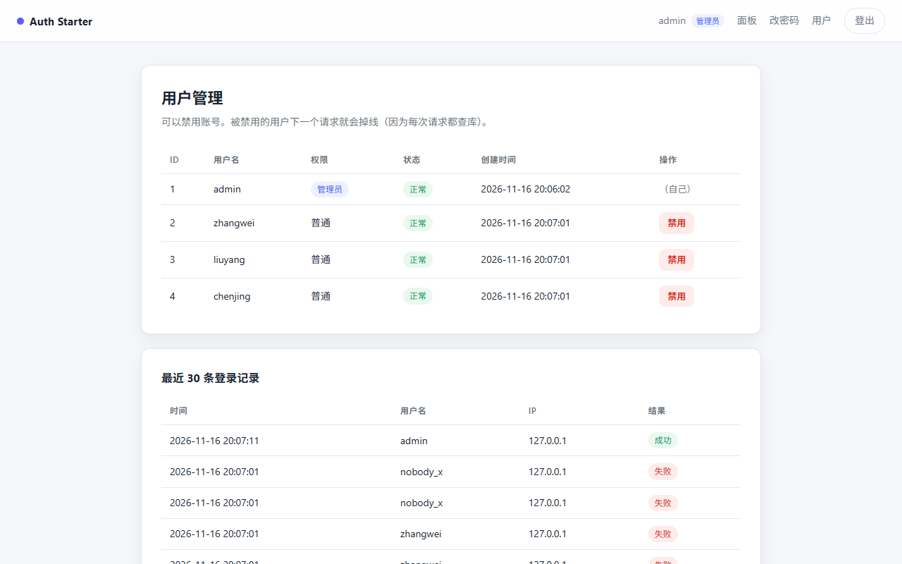

# Auth Starter · Flask 用户系统脚手架

给 Flask 项目加一套**能直接用**的账号系统：注册、登录、记住我、权限分级、改密码、防爆破、登录审计。
代码量小、零重型依赖（不需要 Flask-Login、不需要 ORM），方便二次开发和交付。

## 为什么做这个

接单时最常见的需求就是「给我加个登录」。每次从零写，密码哈希、防爆破、开放重定向这些坑都要重踩一遍。
这个项目把它们固化下来：拿过去注册一个 blueprint，登录部分就不用再动了。

## 功能

| 功能 | 说明 |
|---|---|
| 注册 / 登录 / 登出 | 用户名 3–20 位中英文数字下划线，密码至少 8 位 |
| 密码存储 | `werkzeug.security` 的 scrypt + 随机盐，绝无明文 |
| 记住我 | 勾选后会话 7 天有效，不勾关浏览器即失效 |
| 权限分级 | `@login_required` / `@admin_required` 两个装饰器 |
| 防爆破 | 连续失败 5 次锁定 15 分钟，锁定期内正确密码也进不去 |
| 防用户枚举 | 账号不存在和密码错误返回**同一句**提示 |
| 防开放重定向 | 回跳地址只接受站内路径，`//evil.com`、`http://...` 一律丢弃 |
| 改密码 | 要求验证旧密码，新密码不能与旧密码相同 |
| 登录审计 | 每次尝试都记一条（账号、IP、UA、成功/失败），管理员可看最近 30 条 |
| 用户管理 | 管理员可禁用/启用账号；被禁用者**下一个请求**就掉线（因为每次请求都回库查） |
| 自定义 403 / 404 | 顺带做了 |

## 截图

| 登录页 | 用户面板 | 用户管理与登录审计 |
|---|---|---|
|  |  |  |

## 快速开始

```bash
pip install -r requirements.txt
python app.py          # 默认 5001 端口
```

打开 http://127.0.0.1:5001 ，用 `admin / admin123` 登录。
**上线前务必覆盖这三项：**

```bash
AUTH_SECRET_KEY=<随机 32 字节 hex>
AUTH_ADMIN_PASSWORD=<你的密码>
AUTH_DB_PATH=/var/data/auth.db
```

生成密钥：`python -c "import secrets;print(secrets.token_hex(32))"`

## 目录结构

```
flask-auth-starter/
├── app.py                  # create_app 工厂 + 演示面板 + 错误页
├── config.py               # 全部可调参数
├── models.py               # 数据层（users / login_log 两张表）
├── auth/
│   ├── routes.py           # 注册、登录、登出、改密、用户管理
│   ├── decorators.py       # current_user / login_required / admin_required
│   └── __init__.py
├── templates/
│   ├── base.html
│   ├── dashboard.html
│   ├── auth/{login,register,change_password,users}.html
│   └── errors/{403,404}.html
├── static/style.css
├── tests/selftest.py       # 37 项自动化检查
└── requirements.txt
```

## 设计说明（几个刻意的决定）

**不用 Flask-Login。** 登录态就是 `session["uid"]` 一个整数。自己写的好处是整条链路 40 行看得完，
客户要改（比如接 JWT、接企业 SSO）不用先读懂第三方的魔法。

**session 里只存 id，不存权限。** 每次请求都 `SELECT` 一次用户。多一次查询，换来「管理员禁用某账号立即生效」。
如果账号被禁用，`current_user()` 会直接清掉 session。

**用应用工厂 + blueprint。** 测试可以传一份 `TestConfig` 进去，两个 app 实例互不干扰；
登录模块能整块搬进别的项目。

**失败计数存在数据库里，不在 session 里。** session 可以清、可以换浏览器，存库里才真的能挡爆破。

## 运行测试

```bash
python tests/selftest.py
```

```
37 passed, 0 failed
```

覆盖：未登录拦截、注册全部校验分支、密码长度、用户名格式、重复名、两次密码不一致、
`next=//evil.com` 被丢弃、`next=/auth/password` 正常回跳、连续失败递增、达到上限锁定、
锁定期内正确密码也拒绝、普通用户访问管理页得到 403、改密后旧密码失效、管理员禁用用户后对方立即掉线、
被禁用账号无法登录、管理员不能禁用自己、记住我与会话有效期、密码确实是哈希、登录日志成功/失败都有记录。

## 部署

Render 免费方案：

1. New → Web Service，语言选 Python
2. Build Command：`pip install -r requirements.txt`
3. Start Command：`gunicorn app:app`
4. 环境变量：`AUTH_SECRET_KEY`（必填，随机 32 字节 hex）、`AUTH_ADMIN_PASSWORD`、`AUTH_DB_PATH`
5. 免费实例 15 分钟无访问休眠，冷启动约 50 秒，且无持久磁盘（重新部署后 DB 重置）

任何支持 Python 的服务器都能跑 `gunicorn app:app`。

## 已知限制

- 没有找回密码邮件（需要 SMTP 配置，属于接入方的事）
- 没有 CSRF Token（表单都是 POST + SameSite 默认 Lax，对中小项目够用；要求高的接 Flask-WTF）
- 没有两步验证
- 单进程 SQLite，多实例部署请换 PostgreSQL（只需改 `models.py`）

## License

MIT
